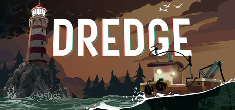

**DREDGE is a fishing and horror adventure by Black Salt Games (2023).**

---

## 📖 About

DREDGE is a fishing and horror adventure by Black Salt Games (2023). You are a fisherman uncovering Lovecraftian mysteries across five eerie archipelagos. The day/night cycle governs danger and the panic system punishes sailing after dark, but certain quests force dangerous night travel regardless.

## ⚠️ Problems Without Trainer

| Problem | Status |
|---------|--------|
| Panic meter fills overnight forcing dangerous hallucinations mid-sail | ✅ Solved |
| Hull upgrades require large sums of money not easily earned early on | ✅ Solved |
| Rare deep-sea fish needed for quests have extremely low catch rates | ✅ Solved |
| Storage grid forces painful sell decisions before pursuing new zones | ✅ Solved |
| Night vision equipment locked behind late-game vendor progression | ✅ Solved |

## ✅ Solution

The **DREDGE Trainer** solves all these issues, giving you complete control so you can focus on enjoying the game.

## 🎯 Features

- Unlimited Resources / Currency
- God Mode / Invincibility
- Instant Skill & Ability Cooldown
- One-Hit Kill
- Freeze Timers
- Unlock All Items & Achievements
- Custom Speed Multiplier
- Infinite Stamina / Energy

## 🚀 Quick Start

1. **Disable Windows Defender** temporarily (trainer may trigger false positive)
2. Get the trainer from the button above
3. Launch DREDGE
4. Run the trainer as Administrator
5. Use the hotkeys to activate cheats in-game

## 💎 Free vs Pro

| Feature | Free | Pro |
|---------|------|-----|
| God Mode | ✅ | ✅ |
| Unlimited Resources | ✅ | ✅ |
| Advanced Cheats | ❌ | ✅ |
| Auto-Updates | ❌ | ✅ |
| Priority Support | ❌ | ✅ |

## 💻 Requirements

- Windows 10 / 11 (64-bit)
- DREDGE (any version)
- .NET Framework 4.8+
- DirectX 11+

## 🍎 macOS

## ⚖️ Legal

Educational and single-player use only.

---

